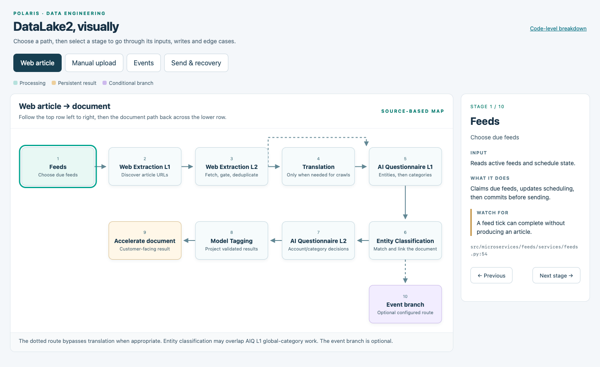
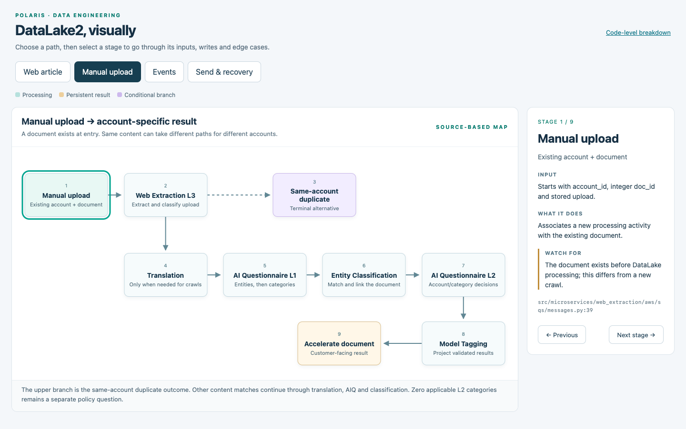
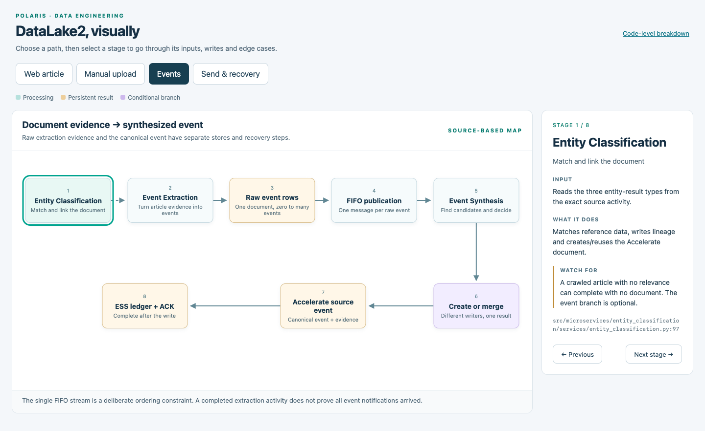
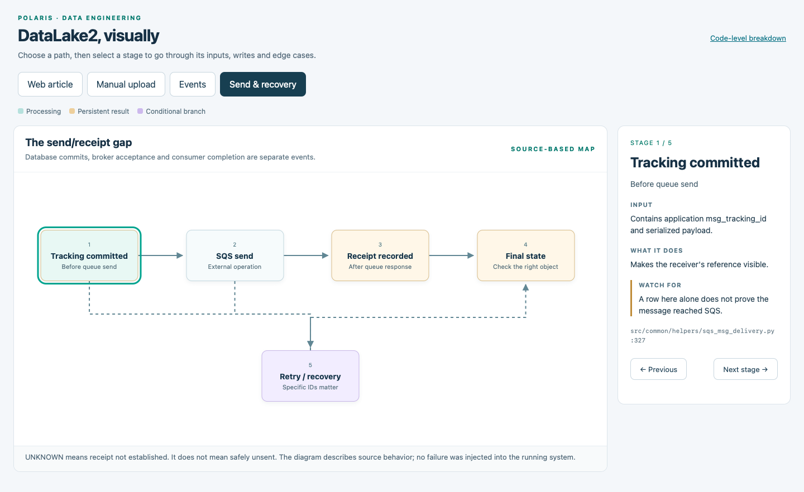
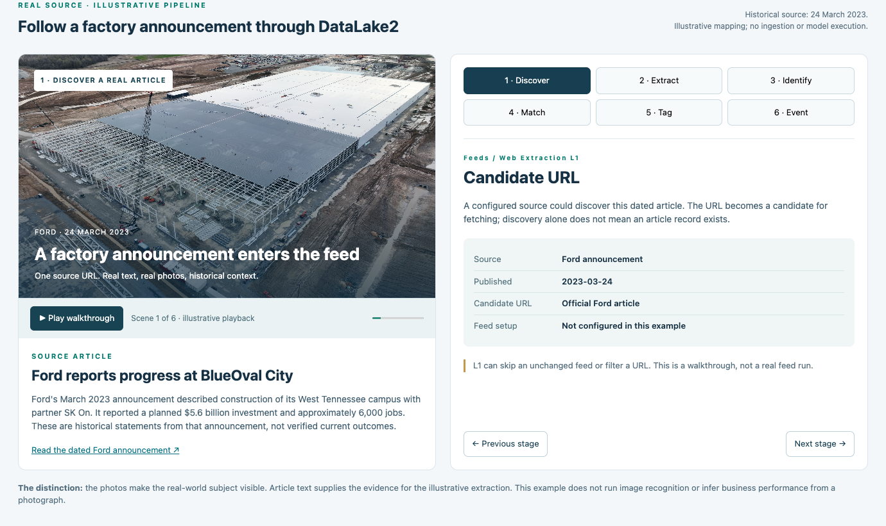
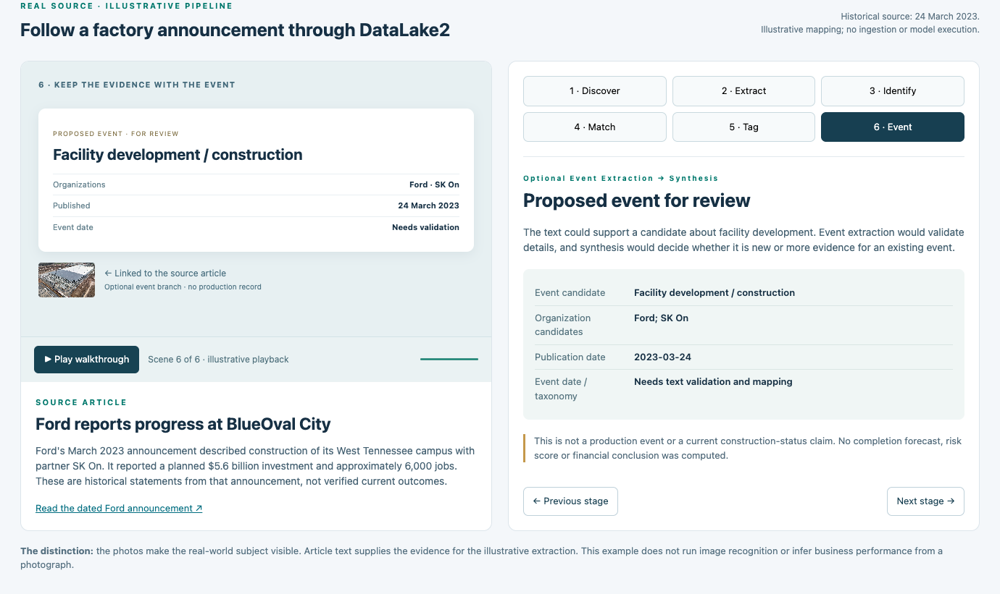
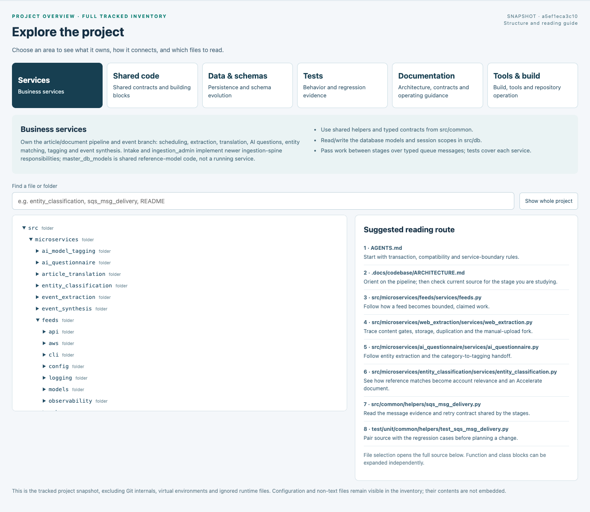
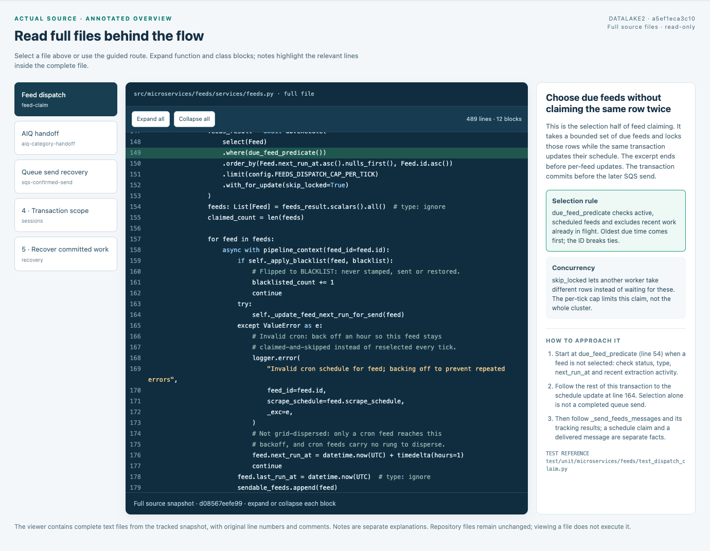
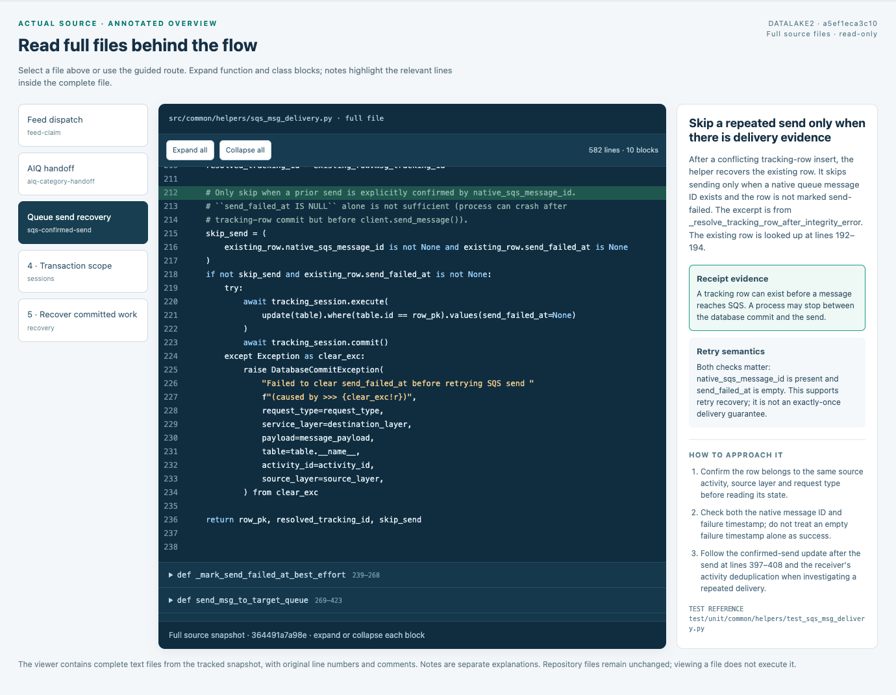
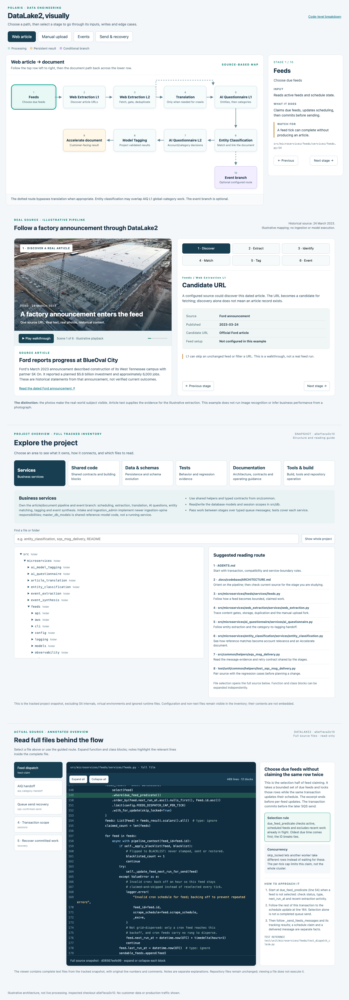

# DataLake2 visualization

An interactive, source-based walkthrough of Polaris I/O's DataLake2 pipeline.

Open `index.html` in a browser, or serve the repository locally:

```sh
python3 -m http.server 8080 --bind 127.0.0.1
```

Then visit <http://127.0.0.1:8080>.

## Explore

- **Web article:** follow a source through extraction, translation, entity matching,
  classification, and the resulting Accelerate document.
- **Manual upload:** inspect the upload-specific entry path.
- **Events:** follow raw event extraction and event synthesis.
- **Send & recovery:** inspect the distinction between database commits, queue
  delivery, and downstream completion.
- **Code explorer:** browse the bundled source snapshot and reading notes.

Select a stage to see its inputs, writes, edge cases, and source references.
`DataLake2-Devil-in-the-Details.html` provides the accompanying technical breakdown.

## Screenshots

The screenshots cover both the four pipeline paths and the supporting sections
below them: the worked example, project explorer, and source-code walkthrough.
Open the walkthrough to select other stages and inspect their details.

### Web article



### Manual upload



### Events



### Send and recovery



### Worked example: source article

The factory-announcement example connects a source article to the pipeline's
processing stages and shows the illustrative record values alongside it.



### Worked example: event interpretation

The event stage shows a proposed event for review, the source evidence, and what
still needs validation. These are illustrative values, not a live extraction.



### Project explorer

Browse the project's responsibilities, service folders, file inventory, and
suggested reading route.



### Source-code walkthrough

The source viewer pairs actual snapshot code with notes explaining selection,
concurrency, and how to approach the implementation.



### Queue recovery in code

The recovery view connects queue-send implementation details with the distinction
between committed work, delivery confirmation, and retries.



### Full-page overview

The entire default page, from the main flow through the lower context sections:



## Source and limits

This repository packages an existing local walkthrough. Its embedded DataLake2
source inventory was captured on **2026-11-09**, at commit
`a5ef1eca3c1072dc895ce5058dbfdd180ca6d6d1` of `PolarisIO/DataLake2`.
The `project-source/` scripts supply full-file views for the explorer.
The `example-images/` directory contains the Ford example photographs; the
walkthrough retains the link to their source article.

The source snapshot and explanatory notes can become stale. Verify behavior
against the current DataLake2 repository before implementation or operational use.
The Ford example is illustrative; the visualization does not run pipeline workers,
connect to databases, submit source content, or generate production results.

Local message drafts, proposed Jira tickets, credentials, and environment files
are not part of this package. The repository is intended to remain **private**
because it includes internal source snapshots.

## Updating

Update the walkthrough and its matching `project-source/` assets together, then
check all four paths, stage navigation, technical links, and code loading in a
browser. Record the new source revision and capture date here.

No dependency installation or build step is required. GitHub Pages is not enabled.
